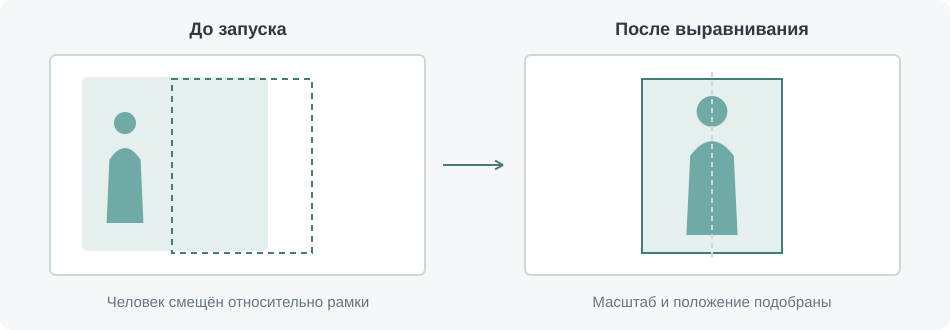
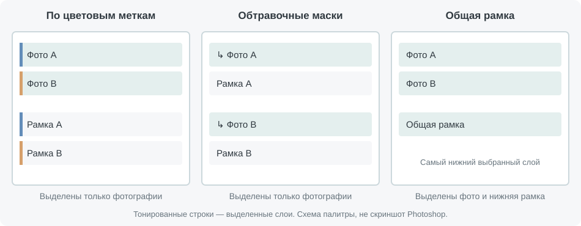
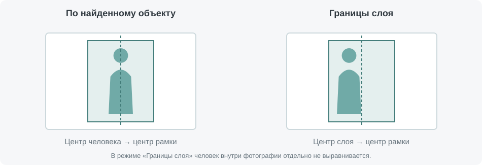
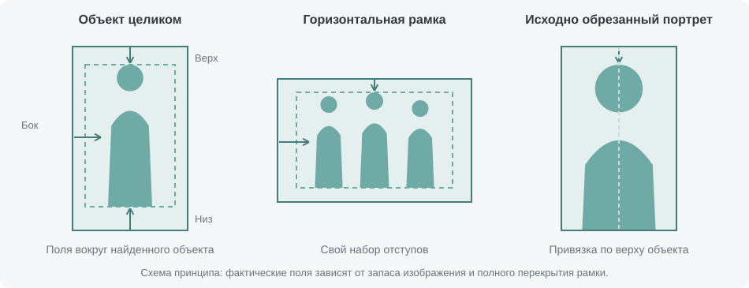

# Align and fit layers для Photoshop

**Align and fit layers** помогает разместить фотографии в готовых рамках. Скрипт определяет положение человека или группы в кадре, подбирает масштаб и выравнивает снимок с учётом заданных отступов. При этом сама фотография должна полностью перекрывать рамку, чтобы по её краям не появлялись пустые участки.

Скрипт можно использовать как для подбора фотографий к отдельным рамкам, так и для выравнивания уже созданных обтравочных масок. Если несколько снимков нужно подогнать к одному размеру и положению, общей рамкой может служить нижний выбранный слой.



## Установка

Полностью распакуйте архив и скопируйте из папки `Photoshop files` файл `Align and fit layers.jsx` вместе с папкой `lib` в папку сценариев Photoshop. Обычно она находится здесь:

```text
C:\Program Files\Adobe\Adobe Photoshop 2026\Presets\Scripts\
```

После перезапуска Photoshop скрипт появится в меню **Файл → Сценарии → Align and fit layers**.

Для работы в режиме **Python** дополнительно запустите `install_runtime.bat`, выберите **Normal secure mode** и дождитесь завершения установки. Если Kaspersky мешает загрузке файлов по HTTPS, повторите установку в режиме совместимости **2**. Установщик загрузит необходимые модели и подготовит отдельную среду в папке `%LOCALAPPDATA%\JazzyScripts\AlignFitRuntime`, не затрагивая системный Python.

Интернет потребуется для установки модуля. Если устанавливать его не хочется, можно использовать доступные способы определения объекта средствами Photoshop или режим **«Границы слоя»**.

При обновлении достаточно заменить `Align and fit layers.jsx` и `lib/align-fit-api.pyw` файлами из нового архива, если в описании выпуска не указано иное. Папка `assets` содержит иллюстрации к этой инструкции и для запуска скрипта не нужна.

## Первый запуск

Для начала возьмите две фотографии и две рамки. Назначьте всем четырём слоям одинаковую цветовую метку Photoshop, затем выделите **только фотографии**. Запустите скрипт, выберите способ определения объекта, задайте отступы и нажмите **«Выполнить»**.

Скрипт сравнит возможные сочетания и распределит снимки между рамками. Чтобы заранее закрепить каждую фотографию за конкретной рамкой, назначьте каждой паре свою цветовую метку или создайте обтравочные маски. Ниже описано, как работают эти варианты и какие слои нужно выделять в каждом случае.

## Подготовка фотографий и рамок



### Отдельные рамки с цветовыми метками

При обычной работе выделяются только фотографии, а рамки остаются невыбранными. Скрипт ищет для каждого снимка рамки с такой же цветовой меткой и оценивает, насколько удачно найденный человек или группа разместятся внутри них. Поэтому горизонтальная фотография может быть назначена вертикальной рамке, если положение объекта позволяет получить более подходящую композицию.

При поиске учитываются все невыбранные слои с нужной меткой. Чтобы в подбор случайно не попали элементы оформления, не назначайте им те же цвета, что и рамкам. После выбора пары фотография перемещается к своей рамке в палитре слоёв и при необходимости становится её обтравочным слоем.

Лучше всего, когда количество фотографий и рамок каждого цвета совпадает. Если рамок не хватает, но их достаточно хотя бы для половины выбранных слоёв, скрипт предложит продолжить или остановить работу. При продолжении фотографии без подходящей рамки останутся на своих местах. Если рамок меньше половины и выбрано несколько слоёв, скрипт перейдёт к общей нижней рамке — этот вариант описан далее.

### Уже созданные обтравочные маски

Если **все выбранные фотографии находятся в обтравочных масках**, скрипт использует их существующие рамки. Цветовые метки в этом случае не влияют на выбор. Можно одновременно выделить фотографии из нескольких обтравочных групп, в том числе несколько снимков с одним общим основанием.

Если обтравочная маска есть только у части выбранных фотографий, весь набор обрабатывается по цветовым меткам. Поэтому для сохранения готовых привязок выбирайте отдельно те фотографии, которые уже связаны с рамками.

### Один общий слой-образец

Чтобы подогнать несколько фотографий к одной области, выделите их вместе со слоем, который будет служить рамкой. Он должен находиться **ниже всех остальных выбранных слоёв**. Такой способ включается автоматически, когда подходящих внешних рамок по цветовым меткам нет или их хватает меньше чем для половины выбранного набора. Проще всего подготовить этот вариант без цветовых меток у выбранных фотографий.

Скрипт переместит и масштабирует фотографии относительно нижнего слоя, сохранив сам образец и порядок слоёв. Новые обтравочные маски при этом не создаются. Если нижний выбранный слой сам является обтравочным, скрипт остановится: такой слой нельзя использовать в качестве общего образца.

## Выбор способа выравнивания

В окне настроек можно выбрать один из четырёх способов работы. Доступность режимов зависит от версии Photoshop и наличия дополнительного модуля.

| Режим | Как работает |
| --- | --- |
| **Python** | Определяет человека или группу, оценивает визуальный центр по горизонтали и количество лиц. Требует установки дополнительного модуля. |
| **autoCutout — on device** | Использует локальное определение объекта средствами Photoshop. Интернет для анализа не нужен. |
| **autoCutout — in cloud** | Использует облачное определение объекта средствами Photoshop. Требуется интернет. |
| **Границы слоя** | Совмещает центр всего слоя с центром рамки и подбирает масштаб для её полного перекрытия. Дополнительный модуль не нужен. |

Первые три режима ориентируются на найденный объект внутри фотографии. Режим **«Границы слоя»** удобен, если кадрирование уже подготовлено или определять человека не требуется. В нём положение человека отдельно не учитывается, а настройки отступов не используются.



Если распознавание отдельной фотографии не дало пригодных границ объекта, скрипт применит к ней правила **«Границы слоя»**, продолжив обработку остальных снимков в выбранном режиме. Это относится именно к неудачному распознаванию: при ошибке запуска Python или связи с сервером скрипт сообщит о проблеме.

В режиме Python также доступна опция **«Учитывать количество лиц при подборе рамок»**, включённая по умолчанию. Она полезна, когда в одном наборе есть одиночные портреты и групповые фотографии: помимо оценки композиции, скрипт старается назначать кадрам с большим количеством людей более крупные рамки.

Эта настройка влияет только на подбор рамок. Для размещения фотографии Python в любом случае определяет визуальный центр по маске фигуры и положению лиц. Явно маленькие отдельные люди на заднем плане могут исключаться из основной группы, чтобы меньше влиять на её центр и подсчёт лиц.

## Отступы и кадрирование

Отступы задают желаемое свободное пространство вокруг найденного человека или группы. Для вертикальных и горизонтальных рамок предусмотрены отдельные значения: сверху и снизу — в процентах от высоты рамки, по бокам — от её ширины.



Когда объект можно показать целиком, скрипт старается вписать его с заданными полями. Верхнее и нижнее поля имеют приоритет перед боковыми, поэтому по сторонам иногда остаётся больше пространства. Например, полнофигурный портрет не должен увеличиваться только ради уменьшения боковых полей, если это приведёт к обрезке ног.

Возможность сохранить отступы зависит от исходного снимка. Если вокруг человека мало свободного изображения, поля приходится уменьшать, чтобы фотография по-прежнему закрывала всю рамку. По этой же причине точное центрирование возможно не всегда. В Python для горизонтального выравнивания используется визуальный центр, а в режимах Photoshop — центр найденной области объекта.

Если объект невозможно показать целиком или он уже обрезан снизу исходным кадром, скрипт ориентируется на его верхнюю границу. Так обрабатываются, например, поясные и погрудные портреты: верхний отступ по возможности сохраняется, а нижняя часть может выходить за рамку. Если изображения над головой недостаточно, верхнее поле тоже уменьшается.

Таким образом, отступы помогают задать композицию, но их точное соблюдение зависит от запаса изображения у краёв. Иллюстрации показывают общий принцип размещения; результат для конкретной фотографии определяется её содержимым.

## Повторное использование настроек

Настройки можно записать в операцию Photoshop. Начните запись операции, запустите скрипт, выберите параметры и выполните выравнивание, после чего остановите запись. Операция сохранит способ определения объекта, отступы и настройку учёта лиц.

Для автоматического выполнения шага отключите у него показ диалога. Если нужно отредактировать параметры операции, откройте соответствующее окно настроек и сохраните изменения.

Во время работы скрипт показывает прогресс Photoshop, начиная с подготовки слоёв. Для прерывания нажмите **Esc**. Основное выравнивание записывается одним шагом истории, поэтому готовый результат можно отменить обычной командой **Отменить**.

## Если что-то идёт не так

Первый запуск в режиме Python может занимать больше времени: серверу нужно загрузить модели. Затем он остаётся в памяти и завершает работу после 15 минут бездействия. Само открытие окна настроек сервер не запускает. Во время анализа индикатор показывает ориентировочный ход ожидания и завершает этап после получения ответа.

Если Python отсутствует в списке режимов, проверьте, что установка завершилась успешно и рядом с JSX находится папка `lib`. Этот режим появляется только при наличии необходимых файлов среды и моделей.

Если вместо отдельных рамок скрипт использует нижнюю фотографию, проверьте цветовые метки и выделение: подходящих рамок найдено слишком мало. Для обычного подбора выбирайте только фотографии, а для общей рамки добавьте к выделению нижний слой-образец.

Если после выравнивания человек остаётся смещённым, сначала проверьте выбранный режим. **«Границы слоя»** центрирует весь снимок. В режимах определения объекта положение также зависит от того, хватает ли изображения по краям для полного перекрытия рамки.

## Удаление

Чтобы удалить скрипт, уберите `Align and fit layers.jsx` и `lib/align-fit-api.pyw` из папки сценариев Photoshop. Если дополнительная среда Python больше не нужна, дождитесь завершения сервера и удалите папку `%LOCALAPPDATA%\JazzyScripts\AlignFitRuntime`.