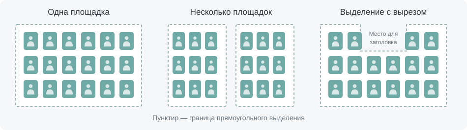
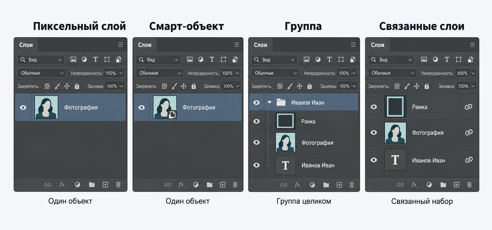
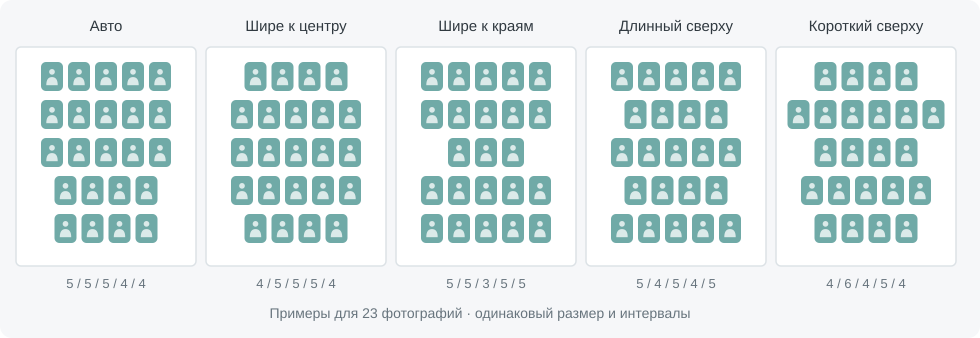
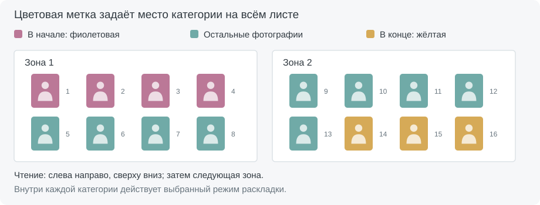

# Auto Layout для Photoshop

Auto Layout раскладывает выбранные фотографии или рамки внутри выделения. Скрипт подбирает ряды, размер объектов и расстояния между ними. Он подходит для школьных альбомов, групповых макетов и других страниц с большим количеством фотографий.

Все объекты получают единый коэффициент масштаба и выравниваются по верхнему краю ряда. Обычная раскладка работает без Python. Дополнительный анализ помогает учитывать имена, пол, разворот человека и цвет одежды.

## Установка и обновление

1. Распакуйте архив.
2. Скопируйте содержимое папки `Photoshop-files` в папку сценариев Photoshop, например:

   ```text
   C:\Program Files\Adobe\Adobe Photoshop 2026\Presets\Scripts\
   ```

3. Перезапустите Photoshop. Скрипт появится в меню **Файл → Сценарии → Auto Layout**.

Для дополнительных функций запустите `install_runtime.bat`. Выберите **Normal secure mode** и дождитесь сообщения **Installation complete**. Если Kaspersky мешает загрузке, используйте **Kaspersky compatibility**. Установщик подготовит отдельный Python и необходимые модели.

При обновлении заменяйте `Auto-layout.jsx` и папку `lib` файлами из нового архива. Оставьте только одну актуальную копию скрипта. Повторная установка Python нужна только тогда, когда это указано в описании обновления.

## Быстрый старт

1. Инструментом **«Прямоугольная область»** выделите место для фотографий.
2. Выберите нужные слои и снимите с них блокировки.
3. Запустите Auto Layout.
4. Задайте параметры и нажмите **«Разложить слои»**.

Для первого запуска оставьте автоматический подбор рядов, ритм **«Авто»** и выравнивание **«По центру»**. Настройки сохраняются при запуске раскладки.

Выделение можно составить из нескольких прямоугольников, а также вырезать в нём место для заголовка, учителя или декора. Используйте добавление и вычитание прямоугольных областей. Кривые и диагональные границы не поддерживаются.



## Какие слои можно использовать

Скрипт работает с обычными слоями, фигурами, смарт-объектами, группами и связанными слоями. Группа или связанный набор считается одним объектом. Их структура и связи сохраняются. Текст внутри объекта помогает определить имя человека.



Связанные слои должны находиться в одной группе или на одном уровне документа. Коррекции и обтравочные маски внутри выбранной группы должны действовать только на её содержимое. Фоновый слой **Background** предварительно преобразуйте в обычный.

Для рамок без фотографий достаточно геометрической раскладки. Анализ цвета предназначен для одежды, а не для цвета рамки. Названия слоёв можно использовать для определения пола и алфавитной сортировки даже без фотографий.

## Ряды и размер фотографий

**Количество рядов.** Автоматический подбор старается разместить фотографии крупно и без лишних одиночных рядов. Чтобы указать число рядов самостоятельно, отключите автоматический режим.

**Вертикальный ритм** задаёт форму всей раскладки:

| Режим | Как располагаются ряды |
| --- | --- |
| Авто | Равномерное заполнение без заданной формы |
| Шире к центру | В средних рядах больше фотографий, чем в крайних |
| Шире к краям | В верхних и нижних рядах больше фотографий, чем в средних |
| Чередование — длинный сверху | Длинные и короткие ряды чередуются, начиная с длинного |
| Чередование — короткий сверху | Чередование начинается с короткого ряда |



Это примеры формы рядов, а не фиксированные шаблоны: результат зависит от выделения и количества фотографий.

Скрипт старается сохранить выбранную форму и симметрию. Для этого ряды могут отличаться на две фотографии. Если места недостаточно или число фотографий не позволяет получить точный рисунок, выбирается доступный вариант.

**Не увеличивать размер слоёв.** Запрещает увеличение относительно текущих размеров. Уменьшение для вписывания остаётся разрешённым.

**Группировать ряды.** Помещает каждый готовый ряд в отдельную группу, чтобы его было удобнее редактировать.

## Выравнивание и интервалы

**По левому краю / По центру / По правому краю** задают положение рядов. Между фотографиями используется общий горизонтальный интервал.

**По ширине** растягивает каждый ряд от края до края за счёт расстояний между фотографиями. Поэтому горизонтальные интервалы в разных рядах могут отличаться.

Если весь блок не может заполнить площадку при допустимых размерах и интервалах, он центрируется. Короткие ряды сохраняют выбранное выравнивание внутри блока. Свободное место сверху и снизу также распределяется поровну, насколько позволяет форма выделения.

**Интервалы X/Y** задают минимальные расстояния по горизонтали и вертикали в процентах от типичной высоты объектов. Параметр максимального увеличения разрешает расширять эти расстояния при наличии свободного места. В режиме **«По ширине»** ограничение увеличения действует только на вертикальный интервал.

## Python и анализ фотографий

**Рассчитывать заполнение площадок в Python** включает расширенный поиск раскладки. Он работает с одним прямоугольником, несколькими площадками и выделениями с вырезами. Без этой галочки геометрию рассчитывает встроенный решатель JSX.

Галочки анализа можно включать независимо от способа расчёта геометрии. Сам анализ требует Python:

| Настройка | Что меняется в раскладке |
| --- | --- |
| Чередовать мальчиков и девочек | Скрипт чередует М/Д внутри рядов и по возможности между ними. Если строгое чередование невозможно, он стремится к внутренней симметрии ряда и размещает меньшинство ближе к центру. |
| Учитывать разворот тела и головы | Портреты распределяются так, чтобы люди были обращены к центру листа. Фотографии при этом не поворачиваются и не зеркалятся. |
| Согласованные цвета | Фотографии с похожими цветами одежды располагаются ближе друг к другу. |
| Максимальный контраст | Скрипт усиливает различия цвета одежды у соседних фотографий. |

Пол сначала определяется по имени, а при необходимости — по фотографии. Поворот и цвет учитываются по всему листу, включая разные ряды и площадки.

Если включены и Python-заполнение, и анализ, скрипт совместно подбирает структуру рядов и состав фотографий. Сначала учитываются границы и заполнение, затем форма рядов, М/Д, поворот и цвет. Ради формы и композиции допускается общее уменьшение размера не более чем на **1% от лучшего найденного масштаба**. Фиксированные экшены сохраняют записанные размеры без такого уменьшения.

Поиск ограничен по времени и сохраняет лучший найденный вариант. При недоступном Python геометрия рассчитывается в JSX. Выбранные галочки не сбрасываются; о технической ошибке анализа скрипт сообщает отдельно. Результат распознавания стоит проверить визуально.

## Сортировка по алфавиту

**В пределах страницы** — единый порядок для всего листа: зона за зоной, сверху вниз и слева направо.

**В пределах зоны** — отдельная сортировка внутри каждой площадки. Сложное выделение с вырезами может состоять из нескольких таких площадок.

Python извлекает имя из названия слоя, пропуская числовые индексы и обычные приписки. Порядок слов сохраняется:

```text
023 Иванов Иван — копия  →  Иванов Иван
023 Иван Иванов — копия  →  Иван Иванов
```

Названия слоёв не меняются. Регистр не учитывается, Ё считается Е. При совпадении имён сохраняется порядок палитры; слои без буквенной подписи идут в конце.

Алфавитная сортировка отключает Python-заполнение, М/Д, поворот и цвет. После её выключения прежние настройки снова доступны. Для самой сортировки Python обязателен.

## Приоритеты по цветовым меткам

Выберите метки в списках **«В начале листа»** и **«В конце листа»**. Например, так можно поставить учителей перед учениками. Сначала идут фотографии первой категории, затем остальные, затем последняя категория. Этот порядок действует на весь лист, независимо от числа зон; граница категорий может проходить внутри ряда.



На схеме цвет карточки обозначает метку слоя, а числа — порядок чтения раскладки.

Внутри категории применяется выбранная раскладка или алфавитная сортировка. Если нужных меток нет, работа продолжается как обычно. Если все фотографии относятся к одной категории, это не ограничивает их размещение. При разделении 50/50 две категории идут подряд, без пустого места между ними.

**«Не задано»** отключает категорию. **«Без цветовой метки»** выбирает непомеченные объекты. Для начала и конца укажите разные метки. У группы используется её собственная метка; связанные слои не должны одновременно относиться к начальной и конечной категориям.

## Экшены и одинаковые размеры на разных листах

Скрипт записывает настройки в экшен Photoshop. При обычном воспроизведении размер фотографий и интервалы заново подбираются под выделение и количество слоёв.

Для серии одинаково оформленных листов включите **«Фиксировать отступы и трансформацию»** и запишите шаг на типовом листе. Экшен сохранит типичную высоту объектов и оба интервала X/Y в пикселях. На следующих листах количество фотографий может меняться.

Все объекты по-прежнему масштабируются одинаково. Ориентиром служит типичная высота объектов: отдельная выступающая подпись не определяет размер всей раскладки. Если высота большинства исходных объектов изменится, масштаб скорректируется под записанную высоту.

При фиксации режим **«По ширине»** центрирует ряды с сохранённым интервалом X. Если раскладка не помещается, скрипт остановится с объяснением. Для одинакового размера при печати используйте одинаковое разрешение документов.

В редакторе фиксированного экшена процентные интервалы и Python-заполнение недоступны. Чтобы заново задать фиксированные размеры или добавить фиксацию в обычный шаг, перезапишите экшен.

## Отмена и повторный запуск

Нажмите **Esc**, чтобы прервать работу и вернуть документ к исходному состоянию. Готовую раскладку можно отменить обычной командой Photoshop, изменить параметры и запустить скрипт снова. Настройки сохраняются между запусками.

## Проверка обновлений

При обычном запуске скрипт проверяет новые релизы GitHub в фоне, не чаще раза в сутки. Проверка работает в Windows и не требует Python. Если ответ ещё не получен, уведомление появится при следующем запуске. В экшенах проверка не выполняется.

Окно показывает версию и текст релиза. Кнопка «Открыть страницу релиза» открывает браузер; скачать и заменить файлы нужно вручную. После открытия страницы, отмены или закрытия окна этот релиз больше не предлагается. Следующее уведомление появится для более новой версии.

Чекбокс «Не проверять обновления» отключает дальнейшие проверки. Ошибки сети не мешают раскладке и не вызывают сообщений.
